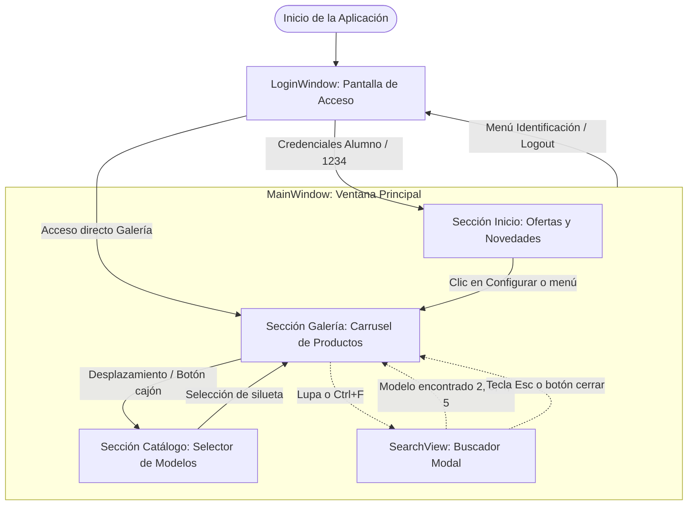

# Memoria Técnica del Proyecto

---

## Portada y Datos de la Entrega

* **Institución:** Universidad Miguel Hernández de Elche (UMH)
* **Centro:** Escuela Politécnica Superior de Elche
* **Titulación:** Grado en Ingeniería Informática en Tecnologías de la Información
* **Departamento:** Estadística, Matemática e Informática (Área de Lenguajes y Sistemas Informáticos - L.S.I.)
* **Asignatura:** Interfaces de Usuario
* **Convocatoria:** Curso Académico 2026/2027 — Práctica 1
* **Título del Proyecto:** Prototipado de aplicación de escritorio comercial con Microsoft Blend y WPF para *Polestar Automotive*
* **Autor / Alumno:** Leonardo Bani
* **Repositorio de Código Público:** [https://gitlab.com/leorise25/umh-polestar_interface.git](https://gitlab.com/leorise25/umh-polestar_interface.git)

---

## 1. Introducción y Contexto del Proyecto

### 1.1. Contexto Empresarial
Polestar es una marca sueca de automóviles eléctricos de altas prestaciones, creada en 2017 como empresa conjunta entre Volvo Car Group y Geely Holding Group. La compañía destaca internacionalmente por su compromiso con la sostenibilidad, su arquitectura tecnológica de propulsión eléctrica y un lenguaje de diseño escandinavo caracterizado por el minimalismo funcional, la sobriedad estética y el rigor geométrico.

En el marco de su estrategia de expansión comercial y desembarco oficial en el mercado español, Polestar se ha asociado con el área de Lenguajes y Sistemas Informáticos (L.S.I.) de la Universidad Miguel Hernández para encargar un prototipo interactivo de escritorio. La aplicación está concebida como una herramienta para salas de ventas y tiendas oficiales (*Polestar Spaces*), permitiendo a clientes y comerciales consultar la gama de vehículos, revisar ofertas estacionales, explorar especificaciones técnicas y gestionar el acceso a servicios corporativos.

### 1.2. Objetivos Fundamentales
El desarrollo se ha enfocado en alcanzar los siguientes hitos docentes y técnicos:
1. **Diseño centrado en el usuario:** Crear una experiencia de interacción agradable, predecible y fluida que transmita los valores de marca de la empresa.
2. **Prototipado en tecnología estándar:** Construir la solución sobre la plataforma WPF (Windows Presentation Foundation) de .NET 8, siguiendo los estándares de diseño y maquetación de Microsoft Blend y Visual Studio.
3. **Aplicación rigurosa de principios de usabilidad:** Implementar principios contrastados de interacción persona-ordenador (heurísticas de usabilidad, accesibilidad, jerarquía visual y tolerancia a fallos).
4. **Arquitectura desacoplada y mantenible:** Separar la lógica de negocio y los datos de la presentación visual mediante el patrón arquitectónico MVVM (Model-View-ViewModel).

---

## 2. Interpretación de Requisitos y Decisiones de Diseño

El enunciado de la práctica establece directrices funcionales y de diseño específicas, las cuales se han abordado de la siguiente manera:

### 2.1. Las Tres Secciones Obligatorias
1. **Pantalla de Inicio (Novedades y Ofertas):**
   * *Requisito:* Mostrar los productos más novedosos, mejores precios, ofertas estacionales y campañas publicitarias.
   * *Solución adoptada:* Sección inicial (`SectionHero`) compuesta por un mosaico cuadricular de los modelos de la gama (Polestar 2, 3, 4 y 5). Cada modelo incorpora distintivos (*badges*) visuales claros y no intrusivos (`OFERTA DESTACADA`, `NOVEDAD SUV`, `CAMPAÑA 2026`, `PRÓXIMAMENTE`) e información comercial contextual al posar el cursor (precios de partida desde 44.900 €, promociones al 0% TAE y opciones de entrega inmediata).
2. **Pantalla de Logueo e Identificación:**
   * *Requisito:* Controlar la introducción de contraseña, gestionar credenciales y realizar un tratamiento eficaz de errores de identificación.
   * *Solución adoptada:* Ventana dedicada (`LoginWindow`) con control de foco, ocultación visual mediante `PasswordBox`, validación de campos vacíos mediante cuadros informativos y verificación del usuario de evaluación (`Alumno` / `1234`). Al superar la validación, se ejecuta una transición animada del logotipo que da paso a la interfaz comercial.
3. **Galería de Productos:**
   * *Requisito:* Visualizar de forma exhaustiva todos los productos que ofrece la empresa.
   * *Solución adoptada:* Galería interactiva dual:
     * *Showcase interactivo (`SectionShowcase`):* Visualizador detallado con carrusel de especificaciones técnicas, motorización, autonomía homologada WLTP, selector numérico (`01 / 04`) y botón directo de configuración.
     * *Selector de catálogo (`SectionBigText`):* Tipografía a gran escala con previsualización fotográfica reactiva (*hover preview*) que permite al usuario comparar visualmente las siluetas de la gama al pasar el cursor.

### 2.2. Elementos Comunes en Todas las Pantallas
* *Requisito:* En todas las pantallas deberán existir como mínimo el menú navegacional y el logotipo corporativo.
* *Solución adoptada:* 
  * Tanto `MainWindow` como `LoginWindow` integran una barra superior homogénea con el logotipo corporativo de la estrella de cuatro puntas y enlaces de navegación directos: **Inicio**, **Galería** e **Identificación** (login/cierre de sesión).
  * Esta coherencia garantiza que el usuario pueda orientarse de inmediato en cualquier punto de la aplicación y volver o entrar sin barreras arquitectónicas.

### 2.3. Política de Animaciones: Uso y No Abuso
* *Requisito:* Uso obligatorio pero mesurado de elementos animados, evitando distraer o ralentizar al usuario.
* *Solución adoptada:* Se ha descartado el uso de transiciones complejas o continuas que causen fatiga visual. Todas las animaciones han sido unificadas mediante la clase de utilidad nativa `AnimationHelper` con curvas de aceleración estándar (`CubicEase`, `QuadraticEase`):
  * *Entrada inicial:* Desvanecimiento sutil (`FadeTo`) de 550 ms para suavizar la carga de la ventana.
  * *Transición de login:* Zoom focalizado en el logotipo durante 600 ms con aceleración cúbica (`ScaleAndFade`).
  * *Cambio de vehículo:* Rotación coordinada del emblema geométrico de fondo (180°) y desvanecimiento cruzado de 250 ms en los textos y silueta del vehículo.
  * *Búsqueda:* Aparición modal atenuada de 280 ms.

---

## 3. Arquitectura del Software y Flujo de Navegación

### 3.1. Patrón Arquitectónico MVVM
Para evitar la concentración de lógica en el código subyacente (*code-behind*) y garantizar un código desacoplado y profesional, el proyecto se estructura bajo el patrón **Model-View-ViewModel (MVVM)** asistido por la biblioteca oficial de Microsoft **`CommunityToolkit.Mvvm`** (v8.4.0):

```
polestar/
├── Models/
│   └── CarModel.cs            # Entidad de datos del vehículo
├── ViewModels/
│   └── MainViewModel.cs       # Lógica de presentación con CommunityToolkit.Mvvm
├── Views/
│   ├── LoginWindow.xaml       # Vista de identificación
│   ├── MainWindow.xaml        # Vista principal (Inicio + Galería + Catálogo)
│   └── SearchView.xaml        # UserControl de búsqueda modal
├── Utils/
│   └── AnimationHelper.cs     # Motor de animación fluida nativa
├── App.xaml                   # Recursos globales de la aplicación
└── images/                    # Recursos multimedia locales
```

* **`CarModel`:** Representa los atributos del vehículo (nombre, subtítulo, descripción técnica, silueta lateral, fotografía en entorno real y etiquetas comerciales).
* **`MainViewModel`:** Hereda de `ObservableObject`. Gestiona la lista observable `ObservableCollection<CarModel>`, la selección activa `SelectedCar`, los indicadores de índice y los comandos reactivos (`NextCarCommand`, `SelectCarCommand`, `OpenSearchCommand`, `ExecuteSearchCommand`) generados limpiamente mediante los atributos `[ObservableProperty]` y `[RelayCommand]`.
* **Vistas XAML:** Consumen las propiedades mediante *DataBinding* bidireccional y unidireccional nativo (`{Binding SelectedCar.Name}`, `{Binding SelectedCar.Description}`), liberando a la vista de manipulaciones manuales de controles.

### 3.2. Diagrama de Navegación



---

## 4. Justificación de Usabilidad y Principios de Diseño de Interfaces

El prototipo ha sido concebido bajo los principios teóricos y metodológicos de la asignatura *Interfaces de Usuario*:

### 4.1. Aplicación de las Heurísticas de Usabilidad de Jakob Nielsen
1. **Visibilidad del estado del sistema:**
   * La interfaz informa continuamente al usuario de su ubicación mediante el menú activo, los indicadores numéricos del carrusel (`01 / 04`) y las respuestas visuales (*hover*) con atenuación de opacidad al situar el ratón sobre tarjetas y opciones clicables.
2. **Correspondencia entre el sistema y el mundo real:**
   * Se utiliza el vocabulario técnico habitual del sector del automóvil eléctrico (kilómetros de autonomía en ciclo WLTP, caballos de vapor CV, arquitectura de 800V, recarga rápida) y convenciones gráficas intuitivas (icono de lupa para buscar, cruz de cierre, asfalto vial estilizado).
3. **Control y libertad del usuario:**
   * El usuario puede moverse bidireccionalmente entre el login y el catálogo sin quedar atrapado en flujos lineales forzados. El panel de búsqueda puede cerrarse en cualquier instante pulsando la tecla `Escape` o el botón de salida.
4. **Consistencia y estándares:**
   * La barra de navegación superior mantiene una posición fija (*sticky header*), el logotipo central actúa como enlace unificado de retorno a la cabecera y los botones de acción principal presentan un formato tipográfico y dimensional homogéneo.
5. **Prevención de errores y gestión:**
   * El formulario de acceso previene el envío de valores no deseados comprobando la presencia de cadenas vacías antes de intentar la autenticación y devolviendo el foco del teclado al campo correspondiente tras emitir el mensaje de aviso.
6. **Reconocimiento antes que recuerdo:**
   * En lugar de obligar al usuario a memorizar especificaciones, la sección de modelos ofrece siluetas transparentes y descripciones resumidas con botones directos para acceder a la ficha técnica completa.
7. **Flexibilidad y eficiencia de uso:**
   * Se proporcionan múltiples caminos para una misma acción: el usuario puede seleccionar un coche haciendo clic en el menú, desplazándose con la rueda del ratón, usando el botón de avance del carrusel o escribiendo el número del modelo en el buscador predictivo.
8. **Estética y diseño minimalista:**
   * Fiel al lema del diseño escandinavo, se prescinde de elementos ornamentales superfluos. La información técnica y visual tiene espacio para respirar mediante márgenes holgados y fondos neutros (#111114 y blanco puro).

### 4.2. Principios de Diseño Visual y Accesibilidad
* **Jerarquía tipográfica:** Clara diferenciación de pesos y tamaños: títulos de sección a 28–34 pt en seminegrilla, subtítulos descriptivos a 13.5–15 pt y textos secundarios a 11–12 pt.
* **Contraste cromático:** Cumplimiento de los umbrales de contraste del estándar WCAG 2.1 sobre fondos oscuros (texto blanco `#FFFFFF` y gris claro `#E0E0E0` sobre fondo `#111114`, superando ampliamente la relación de contraste 7:1).
* **Tamaños de destino de toque/clic:** Todos los elementos interactivos cuentan con una altura mínima de 34 a 44 píxeles para facilitar la precisión del puntero o de pantallas táctiles comerciales.

---

## 5. Plan de Pruebas, Verificación y Depuración Técnica

Durante la fase de construcción se ejecutó un plan sistemático de pruebas funcionales y de interacción:

### 5.1. Matriz de Pruebas de Identificación
| Caso de Prueba | Entrada de Datos | Resultado Esperado | Resultado Obtenido | Estado |
| :--- | :--- | :--- | :--- | :---: |
| **CP-01: Campos vacíos** | Usuario: `""` / Clave: `""` | Diálogo solicitando usuario y contraseña; foco en `txtUsuario`. | Se muestra aviso y se sitúa el foco en el campo. | Correcto |
| **CP-02: Usuario erróneo** | Usuario: `"Invitado"` / Clave: `""` | Diálogo solicitando contraseña o usuario correcto. | Detecta omisión de contraseña. | Correcto |
| **CP-03: Credencial inválida** | Usuario: `"Admin"` / Clave: `"0000"` | Diálogo indicando credenciales incorrectas; foco en campo. | Mensaje de error emergente y reintento permitido. | Correcto |
| **CP-04: Credencial válida** | Usuario: `"Alumno"` / Clave: `"1234"` | Transición fluida con zoom del logo y apertura de `MainWindow`. | Acceso completado sin bloqueos. | Correcto |

### 5.2. Problemas Encontrados y Soluciones Aplicadas
* **Incidencia de doble apertura de ventana:**
  * *Problema:* Al completar la animación de login, la ventana principal `MainWindow` se instanciaba dos veces en pantalla.
  * *Causa identificada:* El evento `Completed` de la animación se había asociado tanto a la propiedad `ScaleX` como a `ScaleY`, provocando dos disparos concurrentes del manejador.
  * *Solución aplicada:* Desacoplamiento del evento de ventana y temporización asíncrona limpia mediante `await Task.Delay(600)` sincronizada con la duración de la animación.
* **Encapsulación y modularidad de animaciones:**
  * *Problema:* El mantenimiento de múltiples objetos `DoubleAnimation` dispersos en el código subyacente reducía la legibilidad y aumentaba el acoplamiento.
  * *Solución aplicada:* Centralización de las transiciones en `AnimationHelper`, estandarizando los parámetros de aceleración (`CubicEase`, `QuadraticEase`) y garantizando una experiencia visual homogénea y fluida.

---

## 6. Recursos, Bibliotecas y Licencias de Terceros

1. **Framework base:** Microsoft .NET 8.0 SDK y Windows Presentation Foundation (WPF).
2. **CommunityToolkit.Mvvm (v8.4.0):**
   * *Autor:* Microsoft / .NET Foundation.
   * *Licencia:* MIT License.
   * *Aportación:* Biblioteca oficial de Microsoft para la implementación del patrón MVVM en .NET moderno, aprovechando los generadores de código fuente C# para producir automáticamente las propiedades observables (`[ObservableProperty]`) y los comandos de interfaz (`[RelayCommand]`).
3. **Motor de animaciones:** Módulo de utilidades nativo `AnimationHelper` basado en `DoubleAnimation` y transformaciones vectoriales de WPF aceleradas por GPU.
4. **Recursos Gráficos y Logotipos:**
   * Material gráfico corporativo de Polestar Performance AB (fotografías de modelos en carretera y siluetas oficiales en PNG con transparencia).
   * *Condiciones de uso:* Empleados estrictamente con fines académicos y de concurso universitario sin ánimo de lucro al amparo del derecho de cita y estudio.

---

## 7. Declaración y Documentación del Uso Responsable de la IA

En estricta observancia de las directrices académicas de la UMH relativas al uso ético y transparente de la inteligencia artificial generativa, se hace constar lo siguiente:

1. **Herramientas empleadas:** Asistentes IA de soporte técnico (Gemini / Claude / ChatGPT) durante las fechas 08/11/2026 y 09/11/2026.
2. **Propósito concreto:** Asistencia en la selección de bibliotecas de animación para WPF (`XamlFlair`), resolución del bug de duplicidad de eventos en el ciclo de vida de ventanas, y asesoramiento sobre buenas prácticas de desacoplamiento con `CommunityToolkit.Mvvm`.
3. **Control y aportación del estudiante:**
   * Todo el código sugerido fue examinado, validado técnicamente y adaptado manualmente a las directrices de la asignatura.
   * La lógica de validación obligatoria dictada en la práctica (`txtUsuario.Text`, `txtPassword.Password`, usuario `"Alumno"` y clave `"1234"`) fue mantenida íntegramente por el alumno.
   * No se compartieron datos personales ni información confidencial.
4. **Registro detallado de interacciones:**
   * La relación cronológica y auditable de los prompts introducidos, respuestas analizadas y modificaciones efectuadas se encuentra recogida de forma íntegra y transparente en el archivo anexo:  
     👉 **[`MEMORIA_USO_IA.md`](MEMORIA_USO_IA.md)**

---

## 8. Repositorio Público y Guía de Ejecución

### 8.1. Enlace al Repositorio
El código fuente íntegro, el historial de confirmaciones de Git y la documentación se encuentran publicados de forma abierta en:
* **URL:** [https://gitlab.com/leorise25/umh-polestar_interface.git](https://gitlab.com/leorise25/umh-polestar_interface.git)
* *Acceso:* Público, sin necesidad de credenciales ni permisos restringidos.

### 8.2. Requisitos de Entorno y Ejecución
* Sistema Operativo: Windows 10 / Windows 11.
* Entorno de desarrollo recomendado: Microsoft Visual Studio 2022 (con la carga de trabajo *Desarrollo de escritorio de .NET*) o Microsoft Blend for Visual Studio.
* Versión de SDK: .NET 8.0 SDK (o superior).

### 8.3. Pasos para Compilar y Ejecutar
1. Clonar el repositorio o descomprimir el paquete de entrega:
   ```bash
   git clone https://gitlab.com/leorise25/umh-polestar_interface.git
   ```
2. Abrir la solución `polestar/polestar.sln` en Visual Studio.
3. Restaurar los paquetes NuGet (automático al compilar o mediante `dotnet restore`).
4. Seleccionar configuración `Debug` o `Release` en plataforma `x64` o `Any CPU`.
5. Ejecutar mediante `F5` o el botón *Iniciar depuración*.
6. En la pantalla inicial de login, introducir las credenciales de evaluación:
   * **Usuario:** `Alumno`
   * **Contraseña:** `1234`
